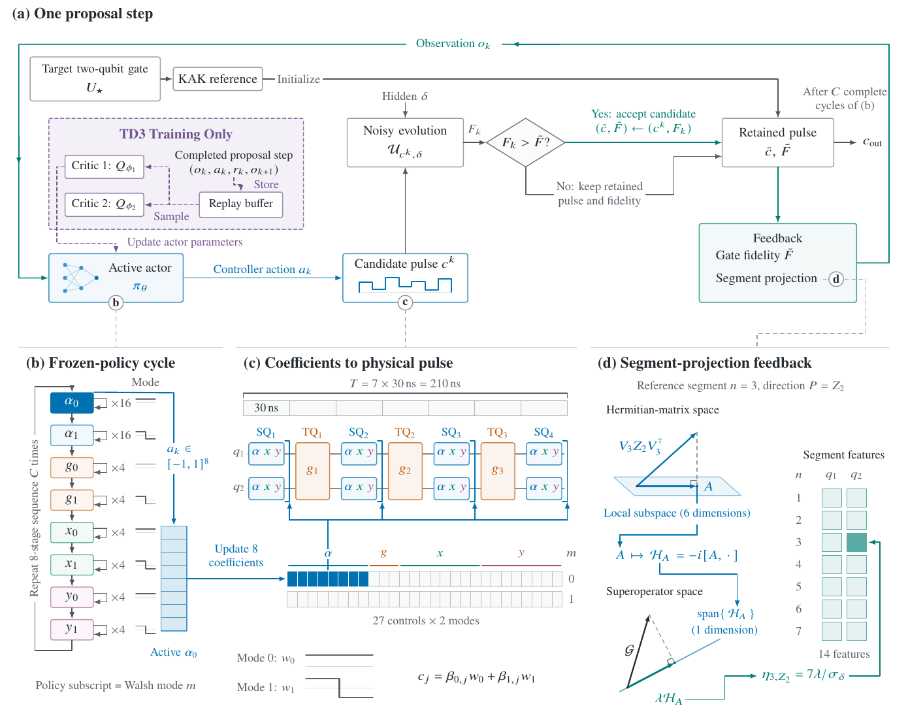

# RL for Robust Two-Qubit Gate Control

Reinforcement learning for feedback-driven calibration of two-qubit gates.
The controller calibrates a target-dependent KAK reference pulse by adjusting
Walsh coefficients, accepting only proposals that improve gate fidelity.
During inference, the trained policies are reused over multiple calibration
cycles without updating their network parameters.

[](figures/method_overview/method_overview.pdf)

**Method overview.** (a) One calibration proposal and the training-only TD3
updates. (b) Eight policies form one inference cycle. (c) Two Walsh modes
parameterize the controls in a seven-segment, 210 ns pulse. (d) Reference-derived
directions relate the final channel residual to individual segments. The
diagram illustrates segment-projection feedback; fidelity-only and global
projection are observation ablations. The experiments use simulated channel
feedback, not a demonstrated hardware measurement protocol.

## Included Methods

- Seven-segment KAK reference pulses and Walsh control parameterization.
- TD3 calibration with accept/reject updates and multiple-cycle inference.
- Segment-projection feedback, with fidelity-only and global-projection ablations.
- Haar-random SU(4) targets, target-specific CNOT training, and detuning studies.
- KAK, GRAPE, and CRAB comparisons.
- Context generation and portable training, evaluation, and benchmark scripts.

Only methods used in the reported experiments will be included. Discarded
approaches, unrelated experiments, and historical run directories are outside
the scope of this repository. Single-qubit matrix operations remain where
needed to construct the local parts of a two-qubit gate.

## Quick Start

Python 3.11 or newer is required. Create and activate a virtual environment,
then install the package and test dependencies:

```sh
python -m venv .venv
# Windows PowerShell: .venv\Scripts\Activate.ps1
# Linux/macOS: source .venv/bin/activate
python -m pip install -c requirements-tested.txt -e ".[train,test]"
python -m pytest -q
```

Run a small CPU check of context generation, all eight training stages, and
two frozen-policy inference cycles:

```sh
python scripts/run_pipeline.py --config configs/su4_segment.yaml --run-dir outputs/smoke --cycles 2 --smoke
```

This uses tiny networks and datasets. It checks the workflow; it does **not**
reproduce the reported scientific results. Outputs are excluded from Git.
The default configuration without `--smoke` is a full training run and is
substantially more expensive.

See [reproduction instructions](docs/reproduction.md) for full training,
checkpoint evaluation, the detuning study, and benchmark commands.

## Configurations

| Configuration | Target | Feedback |
| --- | --- | --- |
| `configs/su4_segment.yaml` | Haar-random SU(4) | Fidelity, six global projections, and segment features |
| `configs/cnot_segment.yaml` | Fixed CNOT | Fidelity, six global projections, and segment features |
| `configs/su4_fidelity.yaml` | Haar-random SU(4) | Fidelity without projection features |
| `configs/su4_global.yaml` | Haar-random SU(4) | Fidelity and six global projections |

All policies also receive the prescribed reference/control information and
proposal history. "Fidelity-only" refers to the error feedback, not to the
entire observation being a single scalar. Noise realizations are not supplied
as actor inputs. Simulator states used internally for propagation or feedback
are distinct from actor observations.

## Artifact Status

The numerical methods, tests, portable scripts, and Figure 1 sources are
included. The extracted calibration code has been compared against its source
revision, and a small training-to-inference run has passed. See
[validation](docs/validation.md) for scope and limitations.

The trained policies used for the reported results, exact evaluation inputs,
and numerical figure/table package are still awaiting release selection.
Figure 1 can be rebuilt now; the other figures cannot yet be regenerated from
this repository. Missing materials and decisions are listed in
[open items](docs/open_items.md). The manuscript and submission materials are
intentionally not included.

## Layout

```text
configs/      Experiment and benchmark settings
src/walsh_rl/ Simulation, reference pulses, calibration, TD3, and benchmarks
scripts/      Context generation, training, inference, and benchmark entry points
tests/        Numerical and calibration checks
figures/      Overview diagram and editable sources
tools/        Figure build and source-parity checks
docs/         Reproduction, provenance, validation, and missing materials
```

## Rebuild the Overview Figure

Install Python 3, a LaTeX distribution providing `pdflatex`, and Poppler
providing `pdftoppm`. The LaTeX source uses `standalone`, `amsmath`, `amssymb`,
`newtxtext`, `newtxmath`, and TikZ. Then run from the repository root:

```sh
python tools/build_overview.py
```

The command rebuilds the linked PDF and PNG preview. It does not require the
simulation environment. See the [figure documentation](figures/method_overview/README.md)
for source organization and rendering options.

## Provenance and Release Information

The selected research-code revision and extraction changes are recorded in
[provenance](docs/provenance.md) and the [source manifest](docs/source_manifest.json).
Licensing, contributor attribution, and citation metadata must be confirmed
by the authors before public release. No license grant is implied by the
temporary absence of a license file.
